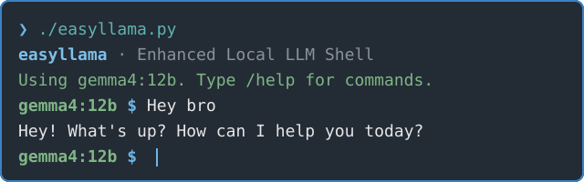

# easyllama

**Enhanced Local LLM Shell**: A friendly shell for chatting with and managing local [Ollama](https://ollama.com) models.



## Install

Requires Python 3 and [Ollama](https://ollama.com/download).

```sh
pip install ollama prompt_toolkit rich
python easyllama.py
```

## Usage

Type to chat, and use `/help` to see all commands.
